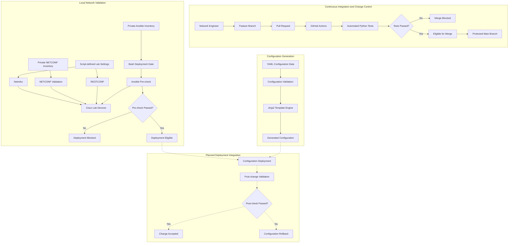

# NetDevOps Automation Platform

[](https://github.com/mukunddharamdas/netdevops-automation-platform/actions/workflows/python-tests.yml)


## Project Overview

A production-style network automation and validation platform
demonstrating modern NetDevOps engineering practices in a lab
environment.

The project focuses on improving network change reliability through
automated state validation, configuration generation, secure device
communication, automated testing, and Git-based change control.

The platform follows a fail-closed approach: failed validation
prevents deployment eligibility rather than allowing potentially
unsafe network changes.

## Engineering Objectives

- Reduce repetitive manual network validation.
- Detect unexpected network states before configuration changes.
- Generate consistent network configurations from structured data.
- Prevent failing code from being merged into the main branch.
- Reduce accidental exposure of credentials and sensitive data.
- Establish a foundation for automated network deployment and rollback.

## Architecture



Solid connections represent implemented workflow components.
Dashed connections represent planned integration.

Live network validation currently runs locally, independently of
the GitHub-hosted testing pipeline.

NETCONF and Ansible use separate private inventories.
Some Netmiko and RESTCONF scripts currently use fixed lab
device and interface expectations.

## Current Capabilities

### Network State Retrieval and Validation

- Retrieve network operational state using Netmiko.
- Parse structured command output using TextFSM.
- Validate required interfaces and operational status.
- Retrieve and validate interface state using NETCONF.
- Retrieve interface configuration and operational data using RESTCONF.
- Aggregate validation results across multiple devices.
- Return nonzero process exit codes when validation fails.

### Configuration Generation

- Store intended network configuration in YAML.
- Validate IP address values before rendering.
- Generate interface configurations using Jinja2 templates.
- Detect undefined template variables using StrictUndefined.
- Display configuration summaries by default.
- Enable explicit configuration inspection when required.

### Inventory Validation

Validate inventory data before requesting device credentials
or establishing network connections.

Validation includes:

- Required device inventory structure.
- Non-empty device lists.
- Required non-empty hostname and host fields.
- Valid integer port numbers between 1 and 65535.
- Non-empty interface lists.
- Required non-empty interface names and expected status strings.

### Ansible Network Automation

- Perform read-only network pre-change validation.
- Validate expected interface states.
- Generate local validation reports.
- Integrate Ansible validation with a Bash deployment safety gate.

### Automated Testing and Change Control

- Python unit and regression testing using pytest.
- GitHub Actions automated test execution.
- Pull request-based change management.
- Protected main branch with required status checks.
- Verified merge blocking using an intentionally failing test.

## Technology Stack

| Technology | Purpose |
|---|---|
| Python | Network automation and validation logic |
| Netmiko | SSH-based network device communication |
| ncclient | NETCONF communication |
| Requests | RESTCONF and HTTP requests |
| YAML / PyYAML | Structured inventory and configuration data |
| Jinja2 | Configuration templating |
| TextFSM | Structured command output parsing |
| Ansible | Network pre-change validation |
| Bash | Deployment safety gate |
| pytest | Automated testing |
| Git | Version control |
| GitHub Actions | Continuous integration |
| Gitleaks | Secret detection |

## Repository Structure

```text
netdevops-automation-platform/
├── .github/
│   └── workflows/
│       └── python-tests.yml
├── ansible/
│   ├── first_playbook.yml
│   ├── inventory.example.yml
│   └── precheck.yml
├── scripts/
│   └── deployment_gate.sh
├── templates/
│   └── interface_config.j2
├── tests/
│   ├── test_config_validation.py
│   ├── test_interface_validation.py
│   ├── test_inventory_validation.py
│   ├── test_netconf_retrieval.py
│   ├── test_netconf_validation.py
│   ├── test_parsed_output.py
│   └── test_render_config.py
├── api_basics.py
├── config_data.yaml
├── config_validation.py
├── inventory.example.yaml
├── inventory_validation.py
├── multi_router_check.py
├── netconf_check.py
├── netconf_validation.py
├── netmiko_basics.py
├── network_validation.py
├── render_config.py
├── restconf_check.py
├── restconf_oper_check.py
├── sandbox_check.py
├── requirements.txt
├── CHANGELOG.md
├── .gitignore
└── README.md
```

Private inventory files, generated reports, environment files,
and local Python environments are excluded through Git ignore rules.

Device credentials are collected interactively by the relevant
Python scripts rather than stored directly in source code.

## Getting Started

### Prerequisites

- Python 3.13
- Git
- macOS or Linux
- Authorized network lab access for live validation
- Ansible and required network collections for Ansible workflows
- Gitleaks for optional local secret scanning

### Clone the Repository

```bash
git clone https://github.com/mukunddharamdas/netdevops-automation-platform.git

cd netdevops-automation-platform
```

### Create a Python Virtual Environment

```bash
python3.13 -m venv .venv
source .venv/bin/activate
```

### Install Python Dependencies

```bash
python -m pip install -r requirements.txt
```

### Run Automated Tests

```bash
python -m pytest -q
```

Offline Python tests do not require access to a live network device.

## Usage Examples

### Generate Network Configuration

```bash
python render_config.py
```

Example output:

```text
Configuration generated successfully
Configuration size: 221 characters
```

To explicitly display the generated configuration:

```bash
python render_config.py --show-config
```

Only display configuration contents in an appropriate local
environment. Avoid publishing sensitive configuration data in
shared logs.

Configuration generation does not modify a network device.

### Prepare a Private Device Inventory

```bash
cp inventory.example.yaml inventory.yaml
```

Update the private inventory with authorized lab device details.

The private inventory is excluded from version control.

### NETCONF Interface Validation

```bash
python netconf_check.py
```

The script validates inventory structure before requesting
credentials or establishing network connections.

Credentials are requested interactively at runtime.

Live execution requires device reachability and independently
trusted SSH host keys.

### Netmiko Interface Validation

```bash
python sandbox_check.py
```

This script retrieves and validates interface state against a
Cisco lab device.

The configured interface expectations must match the intended
lab environment.

Strict SSH host key verification is enabled.

### RESTCONF Interface Validation

```bash
python restconf_check.py
```

This script retrieves interface configuration and validates an
expected interface IP address.

A trusted TLS certificate and authorized device access are
required.

### Ansible Deployment Safety Gate

Prepare the private Ansible inventory:

```bash
cp ansible/inventory.example.yml ansible/inventory.yml
```

Install the Ansible runtime:

```bash
python -m pip install ansible-core==2.21.5
ansible-galaxy collection install -r ansible/requirements.yml
```

Install the network collections required by the Ansible playbooks.

Exact collection versions and reproducible collection installation
instructions are pending dependency verification.

Update the private inventory with authorized lab device details.

Execute the safety gate:

```bash
bash scripts/deployment_gate.sh
```

The gate executes read-only pre-change validation and blocks
deployment eligibility if validation fails.

**No configuration deployment is currently performed.**

### Deployment Gate Exit Codes

| Exit Code | Meaning |
|---|---|
| 0 | Validation passed; deployment eligible |
| 1 | Validation failed; deployment blocked |

Deployment eligibility represents a successful validation result.
It does not mean that configuration changes have been applied.

## Continuous Integration

GitHub Actions automatically runs Python tests when:

- A pull request is opened or updated.
- Changes are pushed to the main branch.

The workflow performs:

1. Repository checkout.
2. Python 3.13 environment setup.
3. Dependency installation.
4. Automated pytest execution.

The main branch is protected through repository rules requiring
pull requests and mandatory Python test status checks.

An intentionally failing pull request was used to verify that
failed tests prevent merging.

Live network device access is not currently part of the
GitHub-hosted workflow.

## Testing and Validation Evidence

| Validation | Observed Result |
|---|---|
| Local Python regression suite | 56 tests passed |
| Inventory validation tests | 27 tests passed |
| Initial GitHub Actions workflow | 29 tests passed |
| Intentionally failing pull request | Merge blocked |
| Ansible pre-change positive test | Passed |
| Ansible pre-change negative test | Deployment blocked |
| Git history secret scan | No findings across 15 commits |
| Current source secret scan | No findings reported |

The 27 inventory validation tests are included in the total
of 56 local tests.

Test counts represent observed development milestones and may
increase as the project evolves.

The expanded 56-test suite has been verified locally.
GitHub Actions verification of the expanded suite is pending
publication of the portfolio-readiness changes.

## Security Controls

The platform incorporates the following security practices:

- Interactive credential collection using getpass.
- Private inventory exclusion through Git ignore rules.
- SSH host key verification enabled in Netmiko and ncclient.
- TLS certificate verification enabled for RESTCONF requests.
- Inventory validation before device connection attempts.
- Reduced exposure of raw exception details.
- Optional rather than default configuration display.
- Fail-closed validation and deployment eligibility decisions.
- Connection cleanup failure handling in validation scripts.
- Protected main branch and mandatory automated tests.
- Local secret scanning using Gitleaks.

### Secret Scanning

Gitleaks is used to detect recognizable secrets in Git history
and current source files.

Install Gitleaks on macOS:

```bash
brew install gitleaks
```

Verify the installation:

```bash
gitleaks version
```

The initial security assessment was performed using Gitleaks 8.30.1.

Scan locally reachable Git history:

```bash
gitleaks git --redact=100 --log-opts="--all" .
```

Select current tracked and non-ignored untracked source files:

```bash
git ls-files --cached --others --exclude-standard
```

Scan the selected source files:

```bash
git ls-files -z --cached --others --exclude-standard | xargs -0 gitleaks dir --redact=100
```

Ignored private inventories and local environments are excluded
from this source-file selection, provided they are not tracked.

### Initial Secret Scan Results

| Scan | Result |
|---|---|
| Git history | No leaks found |
| Historical commits scanned | 15 |
| Current source scan | No leaks found |
| History scan exit code | 0 |
| Source scan exit code | 0 |

Secret scanning is currently performed locally and is not yet
integrated into GitHub Actions.

A successful secret scan does not guarantee that every possible
credential or sensitive value has been detected.

Historical scanning is limited to commits reachable through
the selected local Git references.

## Lab Environment

Development and validation are performed using:

- macOS development workstation.
- Python virtual environment.
- Cisco Catalyst 8000V lab environment.
- GitHub-hosted Ubuntu runners for offline automated tests.

The project is intended for authorized lab use and professional
portfolio demonstration.

## Project Roadmap

### Implemented

- [x] Python network automation foundations
- [x] Structured network state validation
- [x] NETCONF and RESTCONF integration
- [x] YAML-driven configuration data
- [x] Jinja2 configuration generation
- [x] Inventory validation
- [x] Ansible pre-change validation
- [x] Bash deployment safety gate
- [x] Automated Python regression testing
- [x] GitHub Actions continuous integration
- [x] Protected main branch
- [x] Local secret scanning
- [x] Controlled exception logging
- [x] Connection security configuration
- [x] Optional configuration display

### Planned Enhancements

- [ ] Dedicated security and failure-path regression tests
- [ ] Secure live connectivity verification
- [ ] Automated configuration validation pipeline
- [ ] Continuous integration secret scanning
- [ ] Secure live-device pipeline connectivity
- [ ] BGP neighbor-state validation
- [ ] Automated configuration deployment
- [ ] Automated post-change validation
- [ ] Configuration rollback workflows
- [ ] pyATS and Genie network testing
- [ ] Terraform infrastructure automation
- [ ] Docker containerization
- [ ] Kubernetes exploration
- [ ] Network observability and reporting

## Current Limitations

- This is a production-style lab project, not a production
  network deployment.
- Automated configuration deployment is not yet implemented.
- Live network validation currently requires local connectivity
  and interactive credentials.
- Secure live connectivity requires further verification after
  recent connection-security improvements.
- Independent verification of device host keys is required
  before trusted live connections.
- Dedicated tests for all connection and cleanup failure paths
  are still under development.
- GitHub-hosted runners currently execute offline Python tests.
- Some lab scripts contain fixed device and interface expectations.
- Inventory validation currently checks expected status fields
  for non-empty strings rather than supported operational values.
- Exact Ansible collection dependencies are pending verification.
- Secret scanning cannot guarantee complete credential detection.

## Project Status

Active development.

This project is being developed incrementally to demonstrate
practical network automation, infrastructure validation,
software engineering, and NetDevOps change-management practices.
